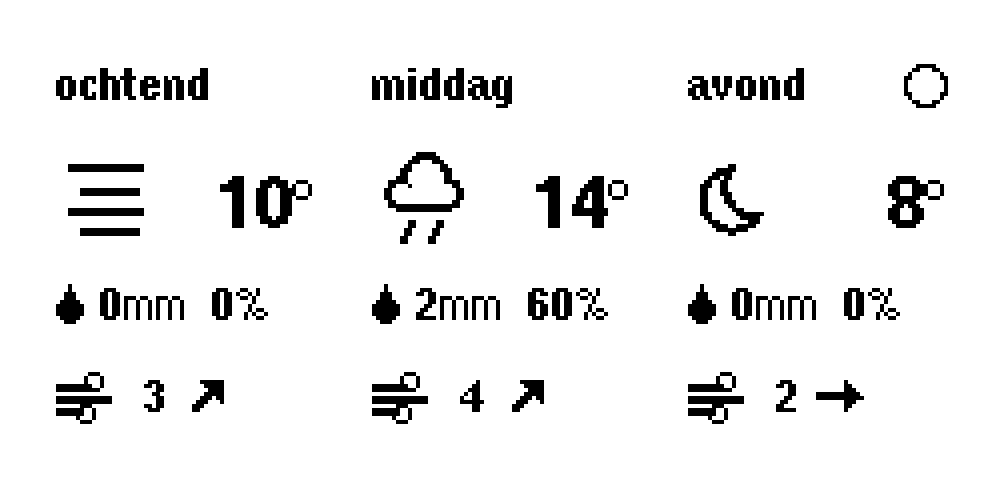

# Weerdisplay voor op de kledingkast

Een klein e-ink-scherm op de kledingkast van een kind. Het toont het weer voor ochtend, middag en avond, zonder knoppen, zonder app en met een batterij die weken meegaat (nog te meten). Je wordt wakker, loopt naar de kast en ziet wat voor weer het wordt.



*Een voorbeeldscherm met voorbeeldgegevens, gemaakt met de echte tekencode.*

## Wat het scherm toont

Drie kolommen, links uitgelijnd, in een rustige Nederlandse grafische stijl zonder lijnen of kaders:

| Onderdeel | Inhoud |
|---|---|
| Kop | ochtend, middag of avond (de avond krijgt de maanstand) |
| Icoon | zon, half bewolkt, bewolkt, mist, regen, sneeuw, onweer of maan (het zwaarste weer in dat dagdeel) |
| Temperatuur | gemiddelde in hele graden |
| Neerslag | hoeveelheid in hele mm en de kans in % |
| Wind | windkracht in Beaufort met een pijl naar de richting waarheen de wind waait |

De kolommen schuiven op met het moment van de dag, zodat je altijd de eerstvolgende dagdelen ziet:

| Verversing | Kolom 1 | Kolom 2 | Kolom 3 |
|---|---|---|---|
| 06:00 | ochtend | middag | avond |
| 11:00 | middag | avond | ochtend (morgen) |
| 17:00 | avond | ochtend (morgen) | middag (morgen) |
| 23:00 | ochtend (morgen) | middag (morgen) | avond (morgen) |

De verversing van 06:00 vernieuwt alleen de voorspelling, zodat je bij het wakker worden de nieuwste hebt. Dagdelen: ochtend 06 tot 12, middag 12 tot 18, avond 18 tot 24.

**Infoscherm:** een druk op de knop (GPIO 39) toont de huidige tijd, laatste en volgende verversing, de batterij (spanning en percentage) en het wifi-signaal (live gemeten). Het blijft staan tot je weer drukt, of 10 seconden. Mislukte verbindingen worden vermeld.

## Hardware

Alles komt van één Nederlandse webshop, [Tinytronics](https://www.tinytronics.nl).

| Onderdeel | Artikelnummer | Prijs (euro) |
|---|---|---|
| LilyGO TTGO T5 V2.3.1 (ESP32 met e-ink-scherm 2,13 inch, 250 x 122, DEPG0213BN) | 002677 | 15,75 |
| PKCELL Li-Po 3,7 V 1200 mAh, JST-PH | 005879 | 6,00 |
| Li-Po adapterkabel type B, JST-PH naar Picoblade | 006060 | 0,80 |
| Micro-USB-datakabel (als je er geen hebt) | - | ca. 3 |

Tinytronics bevestigde schriftelijk dat zij versie T5_V2.3.1_2.13 leveren en dat adapterkabel B (006060) de batterij op het bord aansluit.

## Hoe het werkt

1. Het bord slaapt (diepe slaap) en wordt vlak vóór een verversing wakker.
2. Het maakt wifi aan en zet de klok gelijk via internet.
3. Het haalt de voorspelling voor 2 dagen op bij [Open-Meteo](https://open-meteo.com) (gratis, geen sleutel, HTTPS met certificaatcontrole).
4. Het rekent de drie kolommen uit, ververst het scherm en slaapt weer.
5. Tussen de verversingen draait alleen de klok. Een klokcorrectie zorgt dat het bord op tijd wakker wordt (zie [CODE.md](CODE.md)).

## Veiligheid

- Het bord maakt alleen uitgaande verbindingen. Er luistert niets en er is geen update via wifi (wijzigen kan alleen via USB).
- Het weer komt via HTTPS met een gecontroleerd certificaat. Wie je wifi overneemt kan de functie van het bord daarom niet veranderen.
- Je wifi-gegevens staan alleen in `secrets.h` (nooit delen). Een gastnetwerk (2,4 GHz) wordt aangeraden.

## Aan de slag

In [CODE.md](CODE.md) vind je alles om aan de slag te gaan: wat je bestelt, installeren op Ubuntu, instellingen, uploaden, hoe de code werkt, het klokdata-logboek en problemen oplossen.

## Mappen

```
weerdisplay/       de Arduino-schets (open weerdisplay.ino)
  weerdisplay.ino  hoofdprogramma
  config.h         jouw instellingen (maak van config.h.example, niet gedeeld)
  secrets.h        jouw wifi (maak van secrets.h.example, nooit delen)
  clock.h          verversingsmomenten, klokcorrectie, klokdata-logboek
  weather.h        weerlogica: dagdelen, Beaufort, iconen, maanstand
  ui.h             tekent het scherm en het infoscherm
  net.h            wifi, klok via internet, weer ophalen
  certs.h          basiscertificaten voor de HTTPS-controle
imgs/              voorbeeldafbeeldingen van de schermen
CODE.md            bestellen, installeren, instellingen, uploaden en problemen oplossen
```

De externe Arduino-bibliotheken (GxEPD2, Adafruit GFX, U8g2_for_Adafruit_GFX, ArduinoJson) zitten bewust niet in deze repo; installeer ze via de Bibliotheekbeheerder van de Arduino IDE (zie [CODE.md](CODE.md)).

## Status (3 november 2026)

De eerste versie is geüpload en toont het weer. Op de computer is de rekenlogica getest (Beaufort, maanstand, iconen, kolomindeling, verversingsmomenten, klokcorrectie en logboek). Nog niet op het bord bevestigd: het infoscherm met de knop, de klokcorrectie over meerdere dagen, de verversing om 06:00, 11:00, 17:00 en 23:00 en de batterijduur.

## Licentie en bronnen

Weergegevens: [Open-Meteo](https://open-meteo.com), controleer de gebruiksvoorwaarden. Lettertypen: U8g2 (Helvetica-beeldpunten). Bibliotheken: GxEPD2, Adafruit GFX, U8g2_for_Adafruit_GFX en ArduinoJson. Deze code valt onder de [MIT-licentie](LICENSE).
